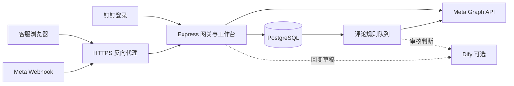

# Social Inbox Gateway

面向 Facebook / Instagram 客服团队的自托管收件箱。使用 **TypeScript、Express 和 PostgreSQL** 接收 Meta Webhook，在同一个工作台查看评论与私信、人工回复、管理评论，并按规则处理新收到的评论。

工作台使用钉钉登录，管理员可以授权主页、分配客服访问范围、维护共享话术和评论规则。可选接入 Dify 生成回复草稿和辅助审核；所有客户回复仍由客服确认发送。

## 功能概览

| 能力 | 当前实现 |
| --- | --- |
| Webhook 接收 | 验证 `X-Hub-Signature-256`，清洗 PostgreSQL JSONB 不接受的字符，在事务中保存载荷和标准化事件 |
| 统一收件箱 | Facebook / Instagram 评论与私信，帖子上下文、评论楼层、搜索、平台与待处理筛选，每页 50 个会话 |
| 人工处理 | 四类消息的文字回复、评论隐藏 / 恢复、点赞 / 取消点赞、删除，以及满足条件时屏蔽 / 解除屏蔽作者 |
| 团队协作 | 钉钉登录、管理员 / 客服角色、按主页授权、共享快捷话术、操作审计 |
| 评论规则 | 平台与主页范围、关键词条件组、排除词、确定短句、可选 AI 判断、试跑、启停和处理日志 |
| 人工审核 | “人工审核 / 规则隐藏 / 无需处理”分类，按单条评论完成审核 |
| 平台同步 | 接收官方端回复与私信回声，叠加 Facebook 评论编辑 / 删除事件，避免把己方回复当作新客户消息 |
| AI 辅助 | 客服按需生成可编辑回复草稿；评论审核可选择隐藏、保留或交人工 |
| 统计 | 当日收件、人工处理和规则处理统计，日期与界面时间使用北京时间 |



## 自动处理的边界

- **只处理新 Webhook 评论。** 评论必须验签通过并首次写入标准化表，才会与入库事务一起进入规则队列。历史数据、外部导入、API 回拉、重复投递、私信和主页自身回复不会触发自动规则。
- **新规则默认关闭。** 管理员必须打开执行开关；“草稿 / 待验证”是整理标签，不代替开关。启用规则不会补处理历史评论。
- **试跑没有平台写操作。** 手工输入或抽样试跑可检查匹配及 AI 结论，但不隐藏、不发送回复，也不创建人工审核待办。
- **开启的审核规则会实际隐藏评论。** 整条评论匹配确定短句可直接隐藏或交人工；其他匹配按配置直接处理或调用 AI。AI 只能从规则允许的动作中选择，必须保留转人工选项。
- **不确定时交人工。** 多规则结论冲突、AI 超时 / 格式错误、权限不足、无法确认平台状态等情况不会被当作成功处理。
- **隐藏前检查平台状态。** 已被平台或人工隐藏的评论跳过；规则关闭 / 修改、评论编辑 / 删除后，尚未发出隐藏请求的任务会重新检查。请求结果不明时只查询状态，不盲目重发。
- **AI 回复规则不能启用自动发送。** 规则编辑器保留回复用途，但当前没有接通可核实的产品知识库，该类 AI 判断转人工。独立的“回复建议”功能仅生成草稿。

## 快速开始

准备 Docker Engine、Docker Compose v2，以及可配置 HTTPS 的域名。完整工作台还需要 Meta 应用、可管理的 Facebook 主页和钉钉登录应用；使用 Instagram 时还需关联账号。基础 Compose 只启动本项目与数据库，不需要 Dify 或 Postiz。

```bash
git clone https://github.com/ANOKO1122/social-inbox-gateway.git
cd social-inbox-gateway
cp .env.example .env
chmod 600 .env
```

编辑 `.env`，填写下表中的 Compose 必填项。将示例域名 `inbox.example.com` 替换成自己的域名；回调地址配置见后文。生成随机密钥可使用：

```bash
openssl rand -hex 24   # 可分别用于数据库密码、验证令牌或内部 API 令牌
openssl rand -hex 32   # META_TOKEN_KEY，必须是 64 位十六进制文本
```

```bash
docker compose config --quiet
docker compose up -d --build --wait
docker compose ps
curl -fsS http://127.0.0.1:4010/health/live
```

Compose 在数据库就绪后执行 SQL 迁移，再启动网关。默认只将网关映射到宿主机 `127.0.0.1:4010`，数据库不发布端口。浏览器登录需要后文的 HTTPS 反向代理。

## 环境变量

`.env` 不应提交到 Git。基础 Compose 面向完整工作台，因此要求填写授权及钉钉配置；直接运行 Node 时，最小 Webhook 服务只要求 `DATABASE_URL`、`META_VERIFY_TOKEN`、`META_APP_SECRET`。

| 变量 | 用途 / 默认值 |
| --- | --- |
| `POSTGRES_PASSWORD` | Compose 必填；数据库用户与库名均为 `sig`。密码嵌入连接串，请使用 URL 安全字符 |
| `DATABASE_URL` | Node 直接运行必填；Compose 自动组装，无需填写 |
| `META_VERIFY_TOKEN` | 必填；与 Meta Webhook 订阅验证令牌保持一致 |
| `META_APP_SECRET` | 必填；校验 Webhook 签名及完成 Meta OAuth |
| `INTERNAL_API_TOKEN` | Compose 必填；内部回复接口的 Bearer 令牌。直接运行时未配置，该接口始终返回 401 |
| `META_APP_ID` | Compose 必填；Facebook 应用 ID |
| `META_OAUTH_REDIRECT_URI` | Compose 必填；例如 `https://inbox.example.com/inbox/connect/facebook/callback` |
| `META_TOKEN_KEY` | Compose 必填；32 字节十六进制密钥，用于加密保存的 Meta 令牌及保护登录会话 |
| `CONNECT_PASSWORD` | Compose 必填；16–128 个字符。仅在未启用钉钉时作为授权页口令；不是 Facebook 密码 |
| `DINGTALK_CLIENT_ID` / `DINGTALK_CLIENT_SECRET` | Compose 必填；钉钉登录使用 Client ID 与 Client Secret |
| `DINGTALK_APP_ID` | 可选，仅作记录，不代替 Client ID |
| `META_GRAPH_VERSION` | 默认 `v23.0`；仅接受 `v数字.数字` 格式 |
| `META_CHANNEL_TOKENS` | 可选 JSON 对象，键为渠道 ID、值为访问令牌；优先于数据库中授权得到的令牌 |
| `DIFY_API_BASE` / `DIFY_API_KEY` | 可选，必须成对配置；Workflow API 地址必须以 `/v1` 结尾，密钥以 `app-` 开头 |
| `RULE_AI_API_KEY` | 可选，独立的规则审核 Workflow API 密钥，与回复草稿共用 `DIFY_API_BASE` |
| `DIFY_DOCKER_NETWORK` | 可选 Dify Compose 覆盖文件使用，默认 `dify_default` |
| `PORT` / `HOST` | Node 默认 `4010` / `127.0.0.1`；Compose 内部固定使用 `4010` / `0.0.0.0` |
| `TEST_DATABASE_URL` | 可选，启用需要 PostgreSQL 的集成测试；只能使用专用测试库 |

直接运行时，Meta 授权的四项配置必须全部设置或全部省略；钉钉登录依赖 Meta 授权配置。`HOST` 只接受 IP 地址或小写 `localhost`，若 shell 自动导出了主机名，请显式覆盖或取消该变量。当前配置加载器在设置 `DIFY_API_BASE` 后也要求 `DIFY_API_KEY`，因此不能只填规则审核密钥而省略回复草稿密钥。

## Meta 应用与主页授权

本项目采用 **Facebook Login 关联 Instagram 账号**的接入路径；不是 Instagram Login 的独立接入实现。

| 用途 | 示例地址 |
| --- | --- |
| 公网 Webhook 回调 | `https://inbox.example.com/inbox/webhooks/meta` |
| Facebook OAuth 回调 | `https://inbox.example.com/inbox/connect/facebook/callback` |
| 主页授权页 | `https://inbox.example.com/inbox/connect` |
| 客服工作台 | `https://inbox.example.com/inbox/workbench` |
| 钉钉登录回调 | `https://inbox.example.com/inbox/auth/dingtalk/callback` |

在 Meta 应用中登记 OAuth 回调，配置 Webhook 回调及验证令牌，然后由管理员在“主页授权”完成 Facebook 登录。应用会换取长期用户令牌，读取可管理主页与关联 Instagram 账号，以 AES-256-GCM 加密保存令牌，并请求 Page 订阅。

代码中的基础权限为：

```text
pages_show_list          business_management
pages_read_engagement   pages_manage_engagement
pages_manage_metadata   pages_messaging
instagram_basic         instagram_manage_comments
instagram_manage_messages
```

常规登录还请求 `pages_read_user_content`、`instagram_manage_engagement`，授权页提供按平台补充权限的入口。删除 Facebook 访客评论、Instagram 点赞等操作依赖额外权限；实际可用性取决于应用获批权限、账号授权和平台返回结果。权限声明可在 `src/connect/scopes.ts` 查看。

Page 订阅字段为 `feed,messages,message_echoes,messaging_referrals,messaging_postbacks`。同时在 Meta 应用后台配置对应 Webhook 对象与字段；Instagram 接收器处理 `comments` 和 `messages` 相关回调。仅保存令牌不代表应用端订阅已配置成功。

## 钉钉登录与首次管理员

1. 在钉钉应用中配置网页登录，登记上表的钉钉回调地址，并将应用的可访问人员范围限制为自己的团队。
2. 填写 `DINGTALK_CLIENT_ID` 与 `DINGTALK_CLIENT_SECRET`。代码以 `openid` 发起授权，再读取当前用户资料取得 `unionId` 与姓名。
3. 部署后由指定负责人首先打开工作台并完成登录：**数据库中的第一位成功登录用户自动成为管理员**。初始化完成前应限制外部访问。
4. 后续登录用户默认为客服，由管理员在“管理”中分配主页和角色；未分配主页的客服没有对应收件访问权限。

回调地址从 `META_OAUTH_REDIRECT_URI` 的 HTTPS 域名自动生成，无需设置独立的 `DINGTALK_REDIRECT_URI`。启用钉钉后，主页授权页只允许管理员访问。代码没有额外的钉钉企业 ID 白名单，团队准入需在钉钉应用侧控制。

## 可选：Dify 回复草稿与审核

[Dify](https://github.com/langgenius/dify) 需要单独部署或使用可访问的服务。本仓库提供 `dify/reply-draft.yml` 回复草稿示例，不包含 Dify 服务、模型凭据或产品知识库。

1. 在 Dify 导入示例 DSL，按自己的环境重新选择模型供应商与模型并配置凭据；模板中的模型标识不保证在其他环境可用。
2. 检查提示词及输入输出后发布 Workflow，取得其 API 密钥。
3. 配置 `DIFY_API_BASE` 与 `DIFY_API_KEY`，重新创建网关容器。客服点击回复建议时才调用该 Workflow，草稿可编辑，发送需人工确认。

回复草稿输入包含 `platform`、`kind`、`text`、`post_text`、`reply_to`、`context`；输出包括 `intent`、`suggested_reply`、`needs_human`、`sources`。没有来源时，网关强制标记为需要人工核实。启用 AI 后，相应客户消息与上下文会发送到你配置的 Dify 及模型服务。

若还需要 AI 评论审核，另建审核 Workflow，参考 `src/dify/rule-prompt.ts`。输入为 `text`、`rule_name`、`goal`、`matched_keywords`、`rule_instructions`、`allowed_actions`、`post_text`；成功结果的 `outputs.text` 必须是包含 `decision` 与 `reason` 的 JSON 字符串，`decision` 仅接受 `hide`、`keep`、`review`。将其密钥写入 `RULE_AI_API_KEY`。仓库未附带该审核 Workflow 的可导入 DSL。

连接同机已有的 Dify Docker 网络时，可使用覆盖文件：

```bash
# .env 中另设置实际的 Dify 地址、API 密钥和网络名，例如：
# DIFY_API_BASE=http://nginx/v1
# DIFY_DOCKER_NETWORK=dify_default
docker compose -f docker-compose.yml -f docker-compose.dify.yml config --quiet
docker compose -f docker-compose.yml -f docker-compose.dify.yml up -d --build --wait
```

该网络必须已经存在，`DIFY_API_BASE` 中的主机名必须能从网关容器解析。后续管理这个部署时也使用相同的 `-f` 组合。连接其他可达的 Dify HTTP(S) 地址时，不需要该网络覆盖文件。

工作台管理导航还保留 `/inbox/dify/` 与 `/launches` 入口，分别用于 Dify 和 [Postiz](https://github.com/gitroomhq/postiz-app)。它们需要另外部署服务并配置反向代理；基础 Compose 不提供这两个页面，也不包含 Postiz 的发帖服务。

## HTTPS 反向代理

网关内部 Webhook 路径是 `/webhooks/meta`，公开示例路径是 `/inbox/webhooks/meta`，需要单独映射；其余 `/inbox/` 路由保留原路径。以下片段放在已有 HTTPS Nginx `server` 中，证书、域名与监听配置自行提供：

```nginx
location = /inbox/webhooks/meta {
    proxy_set_header Host $host;
    proxy_pass http://127.0.0.1:4010/webhooks/meta;
}

location /inbox/ {
    proxy_set_header Host $host;
    proxy_set_header X-Forwarded-Proto $scheme;
    proxy_buffering off;
    proxy_read_timeout 75s;
    proxy_pass http://127.0.0.1:4010;
}
```

此示例假定代理运行在宿主机。容器化代理应使用容器可达地址；容器自己的 `127.0.0.1` 不是宿主机。保持 Webhook 请求体和签名头不变，允许查询参数通过；工作台事件流需要关闭代理缓冲。`/api/events/` 是内部回复接口，示例没有将它映射到公网。

## 主要接口

| 方法 / 路径 | 说明 |
| --- | --- |
| `GET /health/live` | 进程存活检查，返回 `{"status":"ok"}`；不探测数据库 |
| `GET /webhooks/meta` | Meta 订阅验证 |
| `POST /webhooks/meta` | 接收已签名 Webhook，正文上限 1 MiB |
| `POST /api/events/:id/replies` | 根据已保存事件发送文字回复，要求内部 Bearer 令牌 |
| `GET /inbox/workbench` | 需要钉钉登录的客服工作台 |
| `GET /inbox/connect` | 主页授权与订阅状态 |
| `GET /inbox/admin` | 管理角色与主页访问权限 |
| `GET /inbox/admin/rules` | 规则管理与试跑 |
| `GET /inbox/admin/saved-replies` | 共享话术管理 |
| `GET /inbox/admin/statistics`、`GET /inbox/admin/audit` | 统计与操作日志 |

内部回复接口仅接收正文和幂等键，平台对象 ID 从数据库读取：

```bash
curl -sS -X POST 'http://127.0.0.1:4010/api/events/<normalized-event-id>/replies' \
  -H "Authorization: Bearer $INTERNAL_API_TOKEN" \
  -H 'Content-Type: application/json' \
  -d '{"text":"谢谢你的留言","idempotencyKey":"reply-example-0001"}'
```

幂等键格式为 `[A-Za-z0-9_-]{8,128}`；相同键返回已保存结果。已失败的请求需要新的键才能重试。代码限制 Facebook 评论 / 私信正文为 8000 / 2000 字符，Instagram 评论 / 私信为 2200 / 1000 字符；平台自身的回复资格与限制仍适用。

## 开发与数据库迁移

Dockerfile 使用 Node.js 20，Compose 数据库使用 PostgreSQL 16。本地开发需 Node.js、npm 和可访问的 PostgreSQL；项目不会自动加载 `.env`，可以使用 Node 的 `--env-file` 参数：

```bash
npm ci
npm run typecheck
npm test
npm run build
# .env 中应已填写本地 DATABASE_URL，以及需要启用的应用配置
node --env-file=.env dist/db/migrate-cli.js
node --env-file=.env dist/server.js
```

未设置 `TEST_DATABASE_URL` 时，数据库集成测试会跳过。需要时将它指向专用的可丢弃数据库后运行 `npm test`；测试会建表和清理数据，不能指向业务库。上述命令是验证入口，不代表所有环境均已通过测试。

SQL 迁移按文件名顺序执行，记录在 `schema_migrations`，每个文件独立事务并使用数据库锁避免并发迁移。已应用的迁移不要修改；结构变更新增迁移文件。`npm run build` 会复制 SQL 到 `dist/db/migrations/`。

## 目录

```text
src/
  connect/           Meta OAuth、权限、令牌加密与主页授权
  db/migrations/     数据库迁移
  dify/              回复草稿客户端与规则判断协议
  events/            事件标准化、入库、官方回复及修订同步
  meta/              Webhook、Graph 回复与评论操作
  staff/             工作台、钉钉登录、权限、规则队列与统计
  config.ts          环境变量校验
  server.ts          服务与后台规则任务入口
dify/reply-draft.yml  可导入的回复草稿 Workflow 示例
scripts/             构建与测试脚本
```

## 运行注意事项与已知限制

- 容器以非 root 用户、只读根文件系统运行，并配置日志轮转。保持默认回环端口映射；不要直接将数据库或未配置 HTTPS 的工作台暴露到公网。
- `docker compose logs -f gateway` 查看日志，`docker compose stop` 停止服务，`docker compose down` 保留数据库卷；`down -v` 会删除数据。请备份数据库与 `META_TOKEN_KEY`，丢失密钥会使已保存的 Meta 令牌无法解密。
- `POSTGRES_PASSWORD` 只在数据卷首次初始化时设置库内密码。已有数据库改密需要先更新数据库角色，再同步环境配置；只改 `.env` 不会完成改密。
- Webhook 原始表按事件标识派生的批次键去重，不是完整字节归档；同一评论的多次编辑或不同人的 reaction 可能共用键。Facebook 修订同步仍会处理每次收到的回调，但原始载荷不保证保留每个版本。
- 标准化事件按 `(platform, kind, external_id)` 保留首次写入；平台修订另存并叠加显示。保存的载荷是清洗后的 JSON，未保存原始签名字节，不能用于事后原样验签。
- 同步依赖实际收到的新回调，不自动回填全部历史。帖子上下文回拉是有限缓存，不是全量同步；Instagram 编辑 / 删除事件不具备与 Facebook 相同的同步实现。
- 作者屏蔽只对同平台、同主页已有入站私信且 ID 完全匹配的作者开放；其他情况需在原平台处理。Graph 权限、令牌有效性和平台能力决定具体操作是否成功。
- 人工回复存在“平台发送成功、进程在结果落库前退出”的窗口，过期请求接管可能重复发送，不能视为严格的恰好一次投递。
- `/health/live` 只检查进程，数据库故障时仍可能显示 healthy。生产部署应另监测 Webhook 写入失败、授权过期与规则失败，并按业务需要制定客户消息留存和删除策略。
- 测试夹具包含手写样本，接入自己的 Meta 应用后仍需验证真实回调、权限与回复流程。
